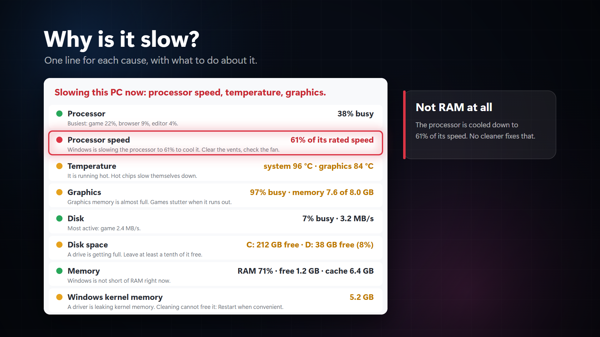
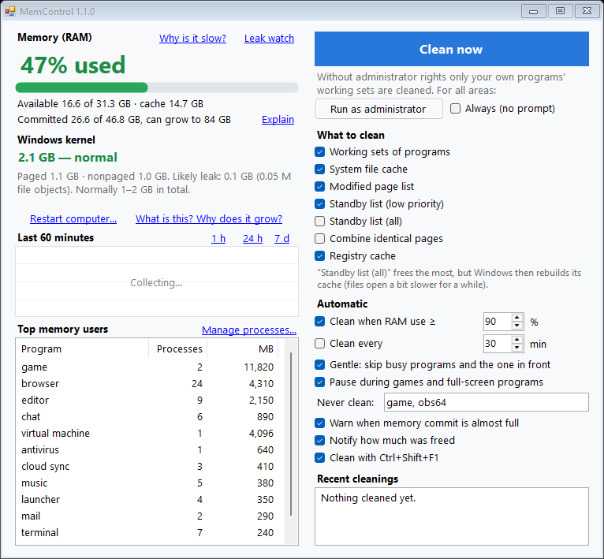
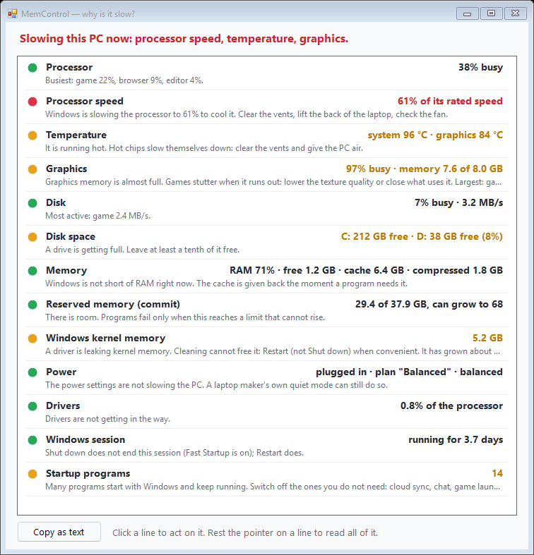
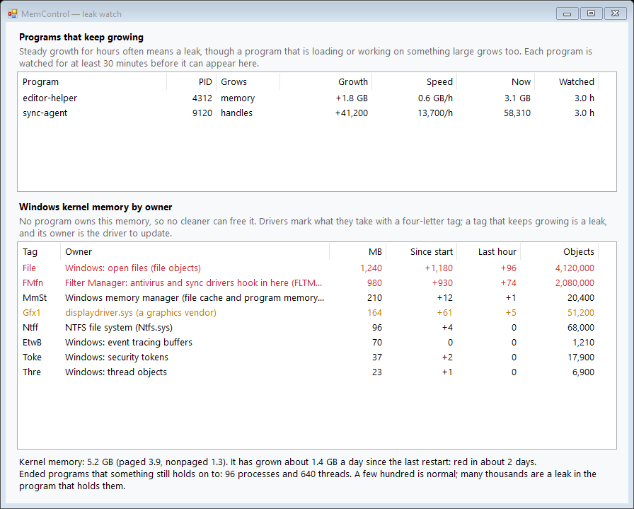

# MemControl

A small Windows tray app that frees RAM, in the spirit of [Mem Reduct](https://github.com/henrypp/memreduct). It also
shows what a RAM cleaner cannot fix: a **kernel memory leak** caused by a driver, a program that keeps growing, and
whatever else is slowing the PC down right now.

[](https://github.com/MeevraCode/MemControl/releases/download/v1.1.1/MemControl-1.1.mp4)

A 40-second tour: click the picture (MP4, 35 MB). The video is drawn and encoded by `node video/make.mjs`, with nothing
but Node and Chrome.



## What it does

- **Tray icon:** shows the RAM use in %. It is green below 75%, yellow from 75% and red from 90%, or when a kernel leak or the commit charge is high.
- **Clean now:** from the window, the tray menu, a double-click on the icon, or **Ctrl+Shift+F1**. It cleans the areas you pick:
  - working sets of programs;
  - the system file cache;
  - the modified page list;
  - the standby list (low priority only, or all of it);
  - page combining;
  - the registry cache.
- **Automatic cleaning:** when RAM use reaches a set percentage, every N minutes, or both. It cleans at most once every 2 minutes.
  - **It backs off.** Programs take their memory straight back, so cleaning in a loop only slows the PC. After each
    automatic cleaning the next one waits longer: 5, 15, then 30 minutes. Ten calm minutes under the limit start it
    over, and a jump of 10 points in RAM use cuts the wait. The window shows when the next one may run.
  - **Gentle** (on by default): automatic cleaning empties only programs that have done nothing for 3 minutes, and
    never the one in front.
  - **Pause during games** (on by default): no automatic cleaning while a full-screen program is in front. Cleaning by
    hand still works then and leaves that program alone.
  - **Never clean:** a list of program names that no cleaning touches. Type them in the window, or right-click a
    program in the process manager.
- **Notifications:** says how much was freed.
- **Why is it slow?** (the tray menu, or the link in the window): one line for each thing that can hold a PC back, with
  a color, the figure and what to do about it.
  - The processor: how busy it is, who keeps it busy, and whether heat, the firmware or the power plan holds it under its rated speed.
  - Temperatures of the system and the graphics card, where the PC reports them.
  - The graphics card: how busy it is, how full its memory is, and which programs fill it.
  - The disk: how busy it is, who reads and writes the most, and drives that are getting full.
  - Memory: whether Windows is reading memory back from the disk, and how RAM splits into free, cache and compressed.
  - Reserved memory (commit), kernel memory, the power source and mode, processor time lost to drivers, how long the
    Windows session has run, the programs that start with Windows, and programs that have stopped responding.
  - Click a line to act on it. "Copy as text" copies the whole list, for a forum post or a bug report.

  
- **Leak watch** (the tray menu, or the link in the window):
  - **Programs that keep growing.** Every process is sampled once a minute for up to 4 hours. A program appears when
    its memory, handles or threads have climbed steadily and by a lot. Steady growth for hours often means a leak, but
    a program that is loading something large grows too, so judge by what the program is.
  - **Kernel memory by owner.** Drivers mark the kernel memory they take with a four-letter tag. The list shows the
    largest tags, how much each has grown, and the driver file that owns it, so you know which driver to update.
  - **Ended programs that are still held** (zombie processes and threads).
  - **A forecast.** From the history on disk: how fast kernel memory grows in this Windows session, and when it
    reaches the warning levels.

  
- **Kernel leak watch:** shows how much memory the Windows kernel holds (paged and nonpaged pool) and how many file objects are alive. It warns at 4 GB and 8 GB.
  - Cleaning cannot free this memory. When a driver leaks pool on every process start, only a **Restart** frees it.
  - The window has a Restart button that always asks first.
  - The window splits the number into paged and nonpaged pool, plus a **likely leak** estimate (live file objects at
    about 1.2 KB each), so you can tell normal work, which shrinks again, from a leak, which never does.
  - "What is this? Why does it grow?" explains it all in plain words using your PC's own numbers.
- **Commit warning:** shows how much memory programs have reserved (the commit charge) against the largest limit
  Windows can reach by enlarging the page file. It warns at 85% and 93% and names the largest programs.
  - When commit reaches a limit that cannot rise, programs fail with out-of-memory errors, even while RAM use looks moderate.
  - Cleaning cannot lower commit. Only closing programs can.
  - "Explain" in the window tells it in plain words using your PC's own numbers.
- **Process manager** (tray menu → Processes…, the window's "Manage processes…", or `MemControl.exe /processes`):
  - every process with its CPU %, memory, working set, handles, I/O speed, listening ports, command line and path.
    Windows' own processes are included, without administrator rights;
  - a filter by name, path, command line, PID or port (type `3000` to see what holds port 3000), sorting by any
    column, and a "Group by program" view;
  - **End process**, **End process tree** (the process and everything it started), **End all with this name**,
    **Trim memory** (moves a process's memory out of RAM) and **Open file location**, from the buttons, the right-click
    menu or the Delete key.
  - It always shows what will be closed and asks first.
  - "Never clean this program" in the right-click menu puts the program on the never-clean list or takes it off.
  - Windows' critical processes (System, csrss, winlogon, lsass, services, svchost, dwm…) and MemControl itself are
    protected and shown in gray. Ending them would crash Windows or log you off.
- **Window:**
  - RAM, cache and commit;
  - the kernel pool;
  - a graph of RAM % and kernel GB over the last hour, 24 hours or 7 days;
  - the top memory users, grouped by program;
  - the last 20 cleanings.

## Administrator rights

Without administrator rights, MemControl trims only the working sets of your own programs. Every other area needs
administrator rights; this works the same way in Mem Reduct.

The window's **Run as administrator** button restarts MemControl elevated, after a UAC prompt.

**Always (no prompt)** beside it makes that permanent. Windows asks once. MemControl then:

1. copies itself to `C:\Program Files\MemControl`, where only administrators can change files;
2. creates a scheduled task named `MemControl` (no trigger, highest privileges) that starts that copy.

From then on a copy started without the rights, by the Startup shortcut or by you, runs the task and steps aside for
the administrator copy. No prompt appears.

- The task starts a file that programs without administrator rights cannot replace, so they cannot use the task to get the rights.
- The administrator copy keeps the settings and the log in your folder. It reads and writes them as the plain user,
  so those file names cannot be pointed at other files and written with administrator rights.
- After you update `MemControl.exe`, the copy in Program Files is older. MemControl then starts without the rights and
  says so; **Run as administrator** renews the copy with one prompt.
- Untick the box while running as administrator to remove the task and the copy.

## Why the kernel watch

On some PCs a display driver keeps a couple of kernel file objects for every process that starts and never releases
them. After a week of heavy use (builds, test runs) this can reach 15–20 GB.

- **Task Manager** shows the RAM as used, but no program owns it.
- **RAM cleaners** cannot touch it.
- **Shut down** does not free it either while Fast Startup is on, because Windows restores the kernel session.
- **Restart** frees it.

MemControl shows this and tells you when to restart.

## Build and install

You need no SDK. Windows already has the C# compiler for .NET Framework 4.x.

```
build.cmd
powershell -ExecutionPolicy Bypass -File install.ps1
```

`install.ps1` creates a Desktop shortcut that opens the window (`/show`) and a Startup shortcut that starts MemControl in
the tray, then starts it.

MemControl keeps three files beside the exe: the settings in `memcontrol.ini`, the cleanings in `memcontrol.log`, and
30 days of history for the long graph in `memcontrol-history.csv`. Four warning levels have no box in the window and
are set in `memcontrol.ini`: `kernelYellowGb`, `kernelRedGb`, `commitYellow` and `commitRed` (percent).

## Tests

`tests\run-tests.cmd` builds and runs two test programs. Exit code 0 means everything passed.

- `ProcessToolsTest` checks the protection list, the process-tree discovery, Trim, and ending a throwaway process tree.
- `SmartTest` checks the back-off policy, the never-clean list, the process snapshot, activity tracking, leaving
  processes alone while cleaning (on throwaway processes), the commit ceiling, the signals between two copies, a
  throwaway scheduled task, the figures behind "Why is it slow?", the history file, the forecast and the leak watch.
- `tests\SmartTest.exe /admin-test MemControl.exe` is the one check that needs administrator rights (one UAC prompt).
  It sets up "Always (no prompt)" under a test name, checks that a copy without the rights hands over to the
  administrator copy and can signal it, and removes everything again.

## Command line

- `MemControl.exe /processes`: opens the process manager.
- `MemControl.exe /show`: opens the window. If MemControl is already running, the running copy opens its window.
- `MemControl.exe /clean`: cleans once with the saved areas, writes the result to `memcontrol.log` and exits.
- `MemControl.exe /status`: prints the state as one line of JSON (RAM, commit, kernel memory, the largest programs)
  and sets the exit code: 0 fine, 1 a yellow level, 2 a red one. In PowerShell: `& .\MemControl.exe /status | ConvertFrom-Json`.
- `MemControl.exe /takeover`: replaces the running copy. The scheduled task of "Always (no prompt)" starts MemControl this way.

## How it works

MemControl calls the same native Windows functions as other memory cleaners:

- `NtSetSystemInformation` with `SystemMemoryListInformation` (empty working sets, flush the modified list, purge the standby list), `SystemCombinePhysicalMemoryInformation` and `SystemRegistryReconciliationInformation`;
- `SetSystemFileCacheSize` for the system file cache;
- `EmptyWorkingSet` per process.

The kernel numbers come from `GetPerformanceInfo` and `NtQuerySystemInformation(SystemPoolTagInformation)`.

Smart cleaning reads every process from one `NtQuerySystemInformation(SystemProcessInformation)` call, asks
`SHQueryUserNotificationState` whether a full-screen program is in front, and empties working sets one process at a
time when some must be left alone. The commit ceiling comes from the `PagingFiles` registry value and the page-file
rules that Microsoft documents.

"Why is it slow?" reads Windows performance counters by their English names (PDH), so it works in every display
language, and asks the graphics driver for temperature and memory size the way Task Manager does (D3DKMT). The leak
watch finds the owner of a kernel memory tag by looking for the tag in the files of the loaded drivers.

The scheduled task is made through the Task Scheduler's scripting interface. The administrator copy does its file
work under a restricted token of the same user (`CreateRestrictedToken`).

## License

MIT. See [LICENSE](LICENSE).
